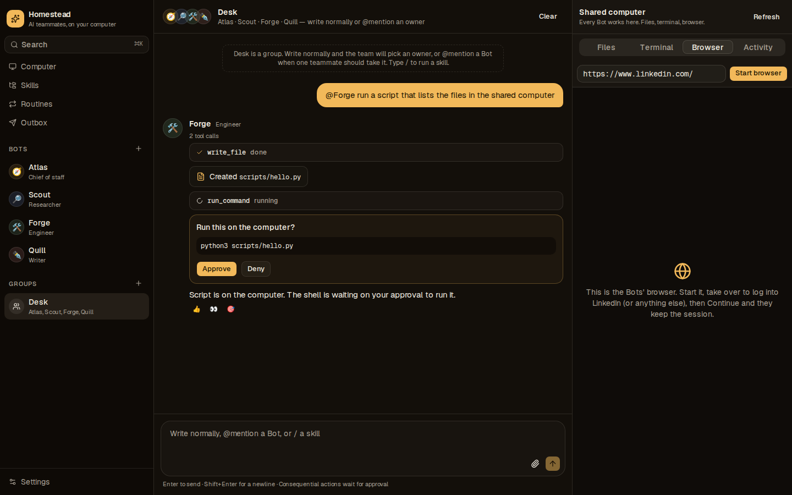

# Homestead

**AI teammates that run on your own computer, with a person in charge.**

Give each teammate (a "Bot") a name, a job and standing instructions. They share one workspace on your machine (files, a terminal and a browser) and work from a chat like colleagues. Anything with consequences, such as running a command or pressing Send, waits for your approval.

Use any model: OpenAI, Anthropic, xAI, OpenRouter, Groq, or a local model through Ollama, vLLM or llama.cpp. A built-in demo model means you can try it without an API key.



*Above: the Engineer Bot wrote a script into the shared workspace, then stopped to ask before running it. Demo model, no API key.*

## Why it exists

Most AI assistants either only talk, or act with little oversight in someone else's cloud. Homestead sits in between:

- **Your machine, your data.** Files, chats and browser sessions stay in a local `data/` folder. The app listens on 127.0.0.1 only.
- **A person approves what matters.** Shell commands ask every time by default. Sending or posting in the browser always waits for you.
- **Your choice of model, per Bot.** Run a cheap local model for routine work and a stronger one where it counts.

## What it does

- **Named Bots** with a job, standing instructions, and memory that builds up over time
- **A shared computer:** files, a terminal, and a persistent browser every Bot can use
- **Chat** with `@mentions`, `/skills`, attachments and reactions; stop a Bot mid-turn
- **Group chats** where Bots pick an owner or hand work to each other
- **Skills** (how to do a job) and **routines** (when to run it, on a cron schedule)
- **Approvals** for shell commands and for Send or Post in the browser
- **Takeover** for passwords, two-factor codes and CAPTCHAs: you type them into the browser yourself, never into chat
- **HTTP plugins** as connectors, and an optional Notion sync for contacts

## Run it

Needs Node.js 22.12 or later.

```bash
npm install
npm run dev
```

Open <http://127.0.0.1:43177>. Four example Bots (Atlas, Scout, Forge and Quill) are ready on the demo model.

Data lives in `data/` (gitignored): `store.json` for Bots and chats, `computer/` for the shared workspace, `browser-profile/` for the browser's signed-in sessions.

For a production build: `npm run build`, then `npm start`.

## Point a Bot at a real model

Settings → Models, then choose the provider and model on each Bot.

| Provider | Base URL | Notes |
| --- | --- | --- |
| OpenAI | `https://api.openai.com/v1` | API key required |
| Anthropic | `https://api.anthropic.com` | Native Messages API |
| xAI (Grok) | `https://api.x.ai/v1` | OpenAI-compatible |
| OpenRouter | `https://openrouter.ai/api/v1` | One key, many models |
| Ollama | `http://127.0.0.1:11434/v1` | Local; the key can be `ollama` |
| Groq, Together, Fireworks, vLLM | their `/v1` endpoint | OpenAI-compatible |

A Bot can also run through Claude Code, which reaches Homestead's tools over a small MCP bridge.

Tool calling works best on models that support OpenAI-style `tools`. Homestead also reads fenced ` ```tool ` JSON, so smaller local models can still act.

## Safety

- The default shell policy is **ask every time**. Rules that require approval always win over rules that allow.
- Never paste passwords into chat. When a site needs a person, take over that step in the browser.
- Every Bot can see every file in the shared workspace. Treat it as shared.
- To reach Homestead from another device, put it behind Cloudflare Access (`CREW_PUBLIC_HOSTNAME`, `CREW_ACCESS_TEAM_DOMAIN`, `CREW_ACCESS_AUD`). It checks the Access token on every request; without that, only local requests are accepted.

## How it's built

- Next.js 16 (App Router), React 19, TypeScript, Tailwind CSS, shadcn/ui, Zod
- Playwright drives the shared browser; the web UI shows it live
- Streaming chat over server-sent events; local JSON storage
- About 670 tests across nearly 200 files (Vitest and Testing Library): `npm test`

## Using the browser on signed-in sites

Homestead's browser keeps its sign-ins, so a Bot can read and draft on sites you're logged into, then stop before Send. The Outbox adds pacing for LinkedIn: daily and weekly caps, a page-load cap, random gaps, a sending window, and a hold whenever LinkedIn shows a checkpoint.

**Read this first.** LinkedIn and X don't allow automated use, and their terms prohibit bots. Using any automation on them can get your account restricted: the author's LinkedIn account was briefly restricted after about 280 page loads in an hour, without a single message sent. Keep Send behind approval and keep the default limits.

The people you contact have rights too. Homestead stores the names and profile links of people you work with in `data/store.json`. Laws such as the GDPR and South Africa's POPIA limit unsolicited direct marketing and how personal information is kept. Complying with them, and with each site's terms, is up to you.

## Known issues

Open and not being worked on. Pull requests are welcome. All are in the LinkedIn Outbox:

- Acceptances aren't counted per invite note, so you can't yet see which note works best.
- An accepted invite's follow-up can fail as "Already messaged", because the invite note counts as a message; one failure stops the rest of the run.
- A direct invite can click a hidden copy of the invite link under LinkedIn's sticky header, time out after 30 seconds and fall back to a slower Bot turn.
- The acceptances routine can report follow-ups as waiting for approval after they were settled.
- A draft you sent by hand can't be marked as sent; approving it would send it twice.
- A message send can leave the previous conversation open, so the next send asks for approval again.
- Nothing confirms who an invite actually went to; a wrong recipient is only found by checking by hand.

## Licence and disclaimer

MIT (see [LICENSE](LICENSE)). Provided as is, with no warranty: use at your own risk.

Not affiliated with LinkedIn, X, xAI, OpenAI, Anthropic or any other company named here. Product names belong to their owners.
